# DA-F26-Assgn3: Assignment Python Programming Fundamentals

**Student Roll Number:** MSDSF25A007  
**Course:** Data Analytics (DA-F26)  
**Assignment:** Python Programming Fundamentals (Assignment 01)

---

## Table of Contents
1. [Overview & Pedagogical Constraints](#overview--pedagogical-constraints)
2. [Scenario Index & Script Mapping](#scenario-index--script-mapping)
3. [Comprehensive Problem Analysis Breakdown & Verification](#comprehensive-problem-analysis-breakdown--verification)
   - [Scenario 01: University Admission Eligibility Checker](#scenario-01-university-admission-eligibility-checker)
   - [Scenario 02: Smart Electricity Bill Calculator](#scenario-02-smart-electricity-bill-calculator)
   - [Scenario 03: Password Strength and Validity Checker](#scenario-03-password-strength-and-validity-checker)
   - [Scenario 04: Student Cafeteria Order and Billing System](#scenario-04-student-cafeteria-order-and-billing-system)
   - [Scenario 05: Personal Monthly Budget Assistant](#scenario-05-personal-monthly-budget-assistant)
   - [Scenario 06: Public Transport Fare Estimator](#scenario-06-public-transport-fare-estimator)
   - [Scenario 07: Online Shopping Checkout](#scenario-07-online-shopping-checkout)
   - [Scenario 08: Library Late-Return Fine Calculator](#scenario-08-library-late-return-fine-calculator)
   - [Scenario 09: Text Message Analyzer](#scenario-09-text-message-analyzer)
   - [Scenario 10: ATM Withdrawal Simulator](#scenario-10-atm-withdrawal-simulator)
   - [Scenario 11: Number Guessing Game](#scenario-11-number-guessing-game)
   - [Scenario 12: Employee Attendance and Salary Assessment](#scenario-12-employee-attendance-and-salary-assessment)
   - [Scenario 13: Restaurant Table Reservation and Seating Plan](#scenario-13-restaurant-table-reservation-and-seating-plan)
   - [Scenario 14: Daily Temperature Monitoring](#scenario-14-daily-temperature-monitoring)
   - [Scenario 15: Digital Savings Goal Tracker](#scenario-15-digital-savings-goal-tracker)
   - [Scenario 16: Cinema Ticket Booking and Revenue Report](#scenario-16-cinema-ticket-booking-and-revenue-report)
   - [Scenario 17: Multiplication Practice and Performance Report](#scenario-17-multiplication-practice-and-performance-report)
   - [Scenario 18: Simple Sales Performance Dashboard](#scenario-18-simple-sales-performance-dashboard)
4. [Master Verification & Test Plan Table](#master-verification--test-plan-table)
5. [Critical Reflection: Overcoming Constraint Challenges](#critical-reflection-overcoming-constraint-challenges)
6. [Submission Checklist Verification](#submission-checklist-verification)

---

## Overview & Pedagogical Constraints
This repository contains end-to-end Python solutions for the 18 real-world computing scenarios prescribed in **Assignment - Python Programming Fundamentals**.

Per course requirements, **strict pedagogical constraints** were adhered to across all implementations:
- **No Advanced Data Structures:** No Python `list`, `dict`, `set`, or `tuple` used to store or buffer input sequences.
- **No Custom Functions or Classes:** All logic is executed via linear control flow, `if/elif/else` branching, and `while`/`for` loop iteration.
- **No External Libraries:** Strictly built using core built-in primitives (`int`, `float`, `str`, `print`, `input`, `len`, `range`).
- **Robust Input Validation:** Rejection of negative monetary quantities, validation of zero/negative denominators, string sanitization, and graceful boundary handling.

---

## Scenario Index & Script Mapping

| # | Scenario Title | Script Filename | Primary Programming Concepts |
|---|---|---|---|
| 01 | University Admission Eligibility Checker | [`scenario_01_admission.py`](scenario_01_admission.py) | Arithmetic operators, multiple conditions, boolean logic |
| 02 | Smart Electricity Bill Calculator | [`scenario_02_electricity.py`](scenario_02_electricity.py) | Progressive tiered calculation, input validation |
| 03 | Password Strength and Validity Checker | [`scenario_03_password.py`](scenario_03_password.py) | String traversal, boolean flag switches, while loop |
| 04 | Student Cafeteria Order and Billing System | [`scenario_04_cafeteria.py`](scenario_04_cafeteria.py) | Interactive loop, menu selection, conditional discount |
| 05 | Personal Monthly Budget Assistant | [`scenario_05_budget.py`](scenario_05_budget.py) | Multiple inputs, accumulator, budget threshold warning |
| 06 | Public Transport Fare Estimator | [`scenario_06_transport.py`](scenario_06_transport.py) | Distance tiering, age-based discount, boundary checks |
| 07 | Online Shopping Checkout | [`scenario_07_checkout.py`](scenario_07_checkout.py) | Indefinite `while` loop, running totals, multi-tiered discount |
| 08 | Library Late-Return Fine Calculator | [`scenario_08_library.py`](scenario_08_library.py) | Progressive fine brackets, zero and negative day validation |
| 09 | Text Message Analyzer | [`scenario_09_text_analyzer.py`](scenario_09_text_analyzer.py) | Manual character inspection, substring matching, string case |
| 10 | ATM Withdrawal Simulator | [`scenario_10_atm.py`](scenario_10_atm.py) | Session state loop, modulus validation, balance guards |
| 11 | Number Guessing Game | [`scenario_11_guess.py`](scenario_11_guess.py) | Attempt counter, range check without penalty, game termination |
| 12 | Employee Attendance and Salary Assessment | [`scenario_12_attendance.py`](scenario_12_attendance.py) | 26-day counted loop, inner reprompting loop, threshold alerts |
| 13 | Restaurant Table Reservation and Seating Plan | [`scenario_13_seating.py`](scenario_13_seating.py) | Nested loops, 2D sequential numbering, capacity validation |
| 14 | Daily Temperature Monitoring | [`scenario_14_temperature.py`](scenario_14_temperature.py) | Running aggregates (min, max, avg), multi-band counters |
| 15 | Digital Savings Goal Tracker | [`scenario_15_savings.py`](scenario_15_savings.py) | Cumulative accumulation loop, early exit, zero-week handling |
| 16 | Cinema Ticket Booking and Revenue Report | [`scenario_16_cinema.py`](scenario_16_cinema.py) | Categorical counters, revenue tallying, zero-division safe avg |
| 17 | Multiplication Practice and Performance Report | [`scenario_17_multiplication.py`](scenario_17_multiplication.py) | Dynamic quiz generator, scoring accumulator, performance rating |
| 18 | Simple Sales Performance Dashboard | [`scenario_18_sales_dashboard.py`](scenario_18_sales_dashboard.py) | Online min/max tracking, tie detection flag, string accumulator |

---

## Comprehensive Problem Analysis Breakdown & Verification

### Scenario 01: University Admission Eligibility Checker
- **Inputs:** Applicant name (`str`), Intermediate marks obtained (`float`), Intermediate total marks (`float`), Entry-test score obtained (`float`), Entry-test total marks (`float`).
- **Processing:**
  1. Validate total marks $> 0$ and obtained marks between $0$ and total marks.
  2. Compute percentages: $\text{Inter \%} = (\text{Obtained} / \text{Total}) \times 100$, $\text{Test \%} = (\text{Test Obtained} / \text{Test Total}) \times 100$.
  3. Check dual eligibility: $\text{Inter \%} \ge 60.0\%$ AND $\text{Test \%} \ge 50.0\%$.
  4. If ineligible, output granular diagnostic explanation (failed intermediate, failed entry test, or failed both).
- **Expected Outputs:** Applicant name, both percentages formatted to 2 decimal places, eligibility status (`ELIGIBLE` / `NOT ELIGIBLE`), and failure reason if applicable.
- **Screenshot:** 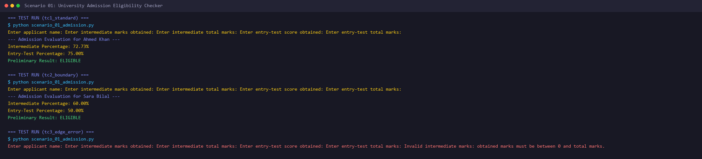

---

### Scenario 02: Smart Electricity Bill Calculator
- **Inputs:** Consumer name (`str`), monthly electricity units consumed (`float`).
- **Processing:**
  1. Reject negative consumption with clear error message.
  2. Apply progressive tariffs across consumption slabs:
     - Tier 1: $\le 100$ units @ Rs. 10/unit.
     - Tier 2: Next 100 units ($101 - 200$) @ Rs. 15/unit.
     - Tier 3: Above 200 units @ Rs. 20/unit.
  3. Compute sum of charges incurred in each slab.
- **Expected Outputs:** Consumer name, units consumed, and total progressive bill (Rs.).
- **Screenshot:** 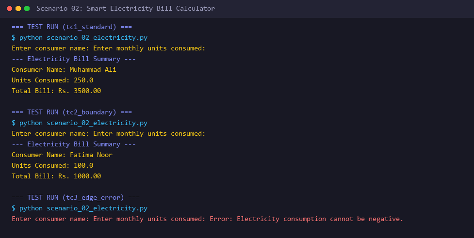

---

### Scenario 03: Password Strength and Validity Checker
- **Inputs:** Proposed password string (`str`), loop exit trigger `'STOP'`.
- **Processing:**
  1. Evaluate character length $\ge 8$.
  2. Traverse password character-by-character using boolean switches to detect:
     - At least one uppercase letter (`.isupper()`).
     - At least one lowercase letter (`.islower()`).
     - At least one digit (`.isdigit()`).
  3. Print status checklist of missing vs. satisfied rules without printing the plain password text (security compliance).
- **Expected Outputs:** Rule checklist evaluation, acceptability status, and reprompt until valid or terminated.
- **Screenshot:** 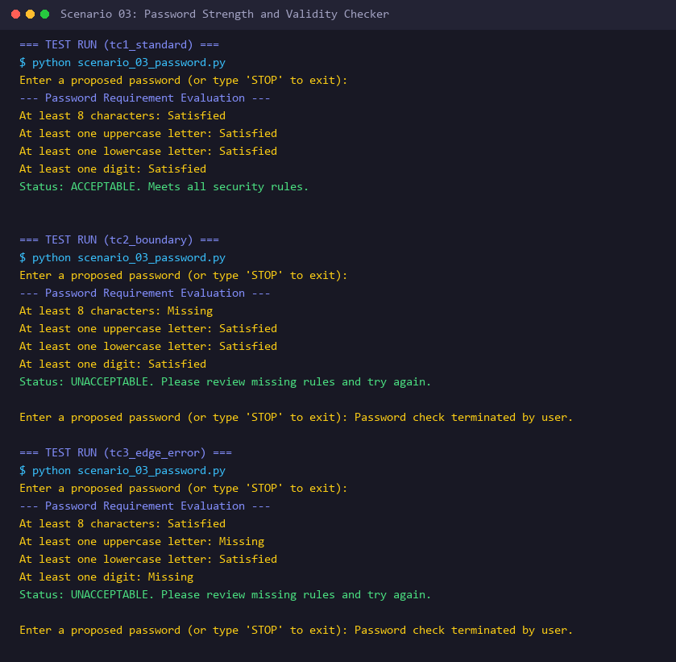

---

### Scenario 04: Student Cafeteria Order and Billing System
- **Inputs:** Customer name (`str`), menu item selection (`1-4` or name), quantity (`int`), finish sentinel `'done'`.
- **Processing:**
  1. Menu items: Sandwich (Rs. 250), Burger (Rs. 400), Pizza slice (Rs. 300), Juice (Rs. 120).
  2. Validate positive integer quantity and valid menu selections.
  3. Maintain running subtotal. Upon `'done'`, evaluate order threshold $\ge \text{Rs. } 1,000$ for a $10\%$ discount.
- **Expected Outputs:** Item addition acknowledgments, itemized receipt with subtotal, discount amount, and final total payable.
- **Screenshot:** 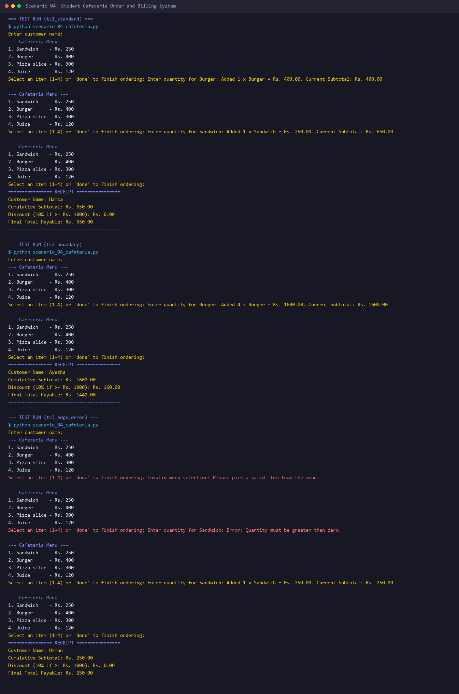

---

### Scenario 05: Personal Monthly Budget Assistant
- **Inputs:** Student name (`str`), monthly allowance (`float`), expense values for food, transport, internet, books, personal (`float`).
- **Processing:**
  1. Validate non-negative allowance and non-negative expense entries.
  2. Calculate total expenditure = sum of expenses; remaining balance = allowance - total expenditure.
  3. If allowance $> 0$, compute percentage spent: $(\text{total\_exp} / \text{allowance}) \times 100$.
  4. Classify position: "Within Budget", "Budget Exhausted", or "Overspending".
  5. Trigger explicit warning if spent percentage $> 80\%$.
- **Expected Outputs:** Summary report with allowance, total expenditure, remaining balance, percentage spent, and status classification.
- **Screenshot:** 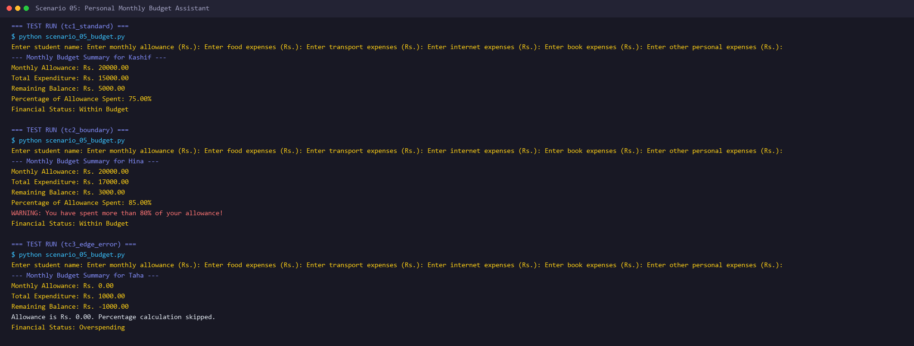

---

### Scenario 06: Public Transport Fare Estimator
- **Inputs:** Passenger name (`str`), passenger age (`int`), travel distance in km (`float`).
- **Processing:**
  1. Validate age $\ge 0$ and distance $> 0$.
  2. Determine distance tier:
     - $\le 5$ km: Rs. 50
     - $> 5$ to $15$ km: Rs. 100
     - $> 15$ to $30$ km: Rs. 180
     - $> 30$ km: Rs. 250
  3. If age $\ge 60$, apply a $20\%$ senior citizen discount on the base fare.
- **Expected Outputs:** Formatted ticket displaying distance, age, base fare, discount amount, and final payable fare.
- **Screenshot:** 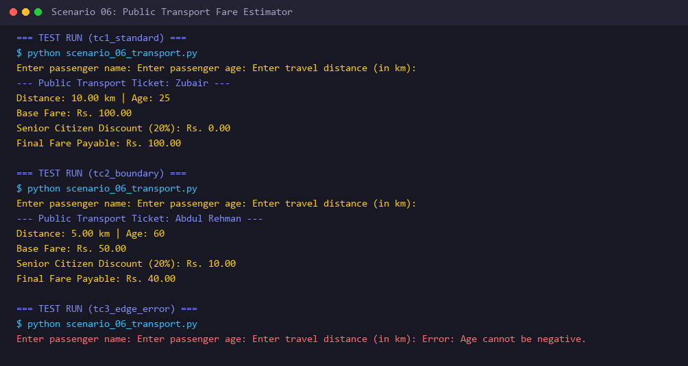

---

### Scenario 07: Online Shopping Checkout
- **Inputs:** Customer name (`str`), product name (`str`), unit price (`float`), quantity (`int`), sentinel `'finish'`.
- **Processing:**
  1. Validate price $\ge 0$ and quantity $> 0$.
  2. Maintain running cumulative subtotal and running total unit count (sum of quantities).
  3. Apply highest eligible discount tier:
     - Subtotal $\ge \text{Rs. } 5,000 \implies 10\%$ discount.
     - Subtotal $\ge \text{Rs. } 2,000 \implies 5\%$ discount.
     - Else $0\%$ discount.
- **Expected Outputs:** Checkout summary showing total items purchased, gross subtotal, applied discount percentage, discount savings, and net bill.
- **Screenshot:** 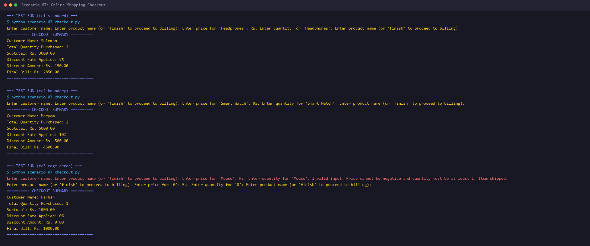

---

### Scenario 08: Library Late-Return Fine Calculator
- **Inputs:** Student name (`str`), book title (`str`), days late (`int`).
- **Processing:**
  1. Validate non-negative days late.
  2. If days late $= 0$, issue an on-time confirmation with Rs. 0 fine.
  3. Apply progressive fine brackets:
     - First 5 days: Rs. 10/day.
     - Days 6 to 10: Rs. 20/day.
     - Days beyond 10: Rs. 50/day.
- **Expected Outputs:** Library fine statement detailing book title, student name, days late, and computed progressive fine.
- **Screenshot:** 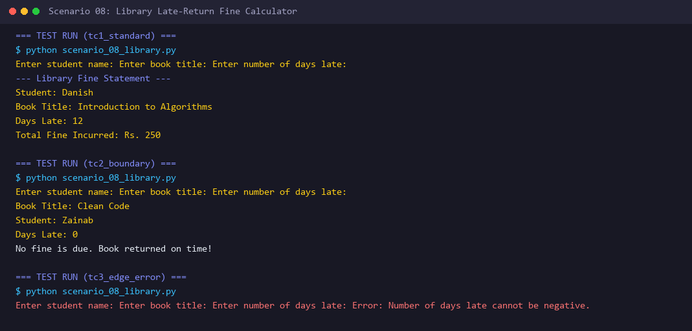

---

### Scenario 09: Text Message Analyzer
- **Inputs:** Raw input sentence (`str`), search phrase (`str`).
- **Processing:**
  1. Determine character length using `len(msg)` and stripped length using `len(msg.strip())`.
  2. Single-pass character inspection for vowels (`a, e, i, o, u`), digits (`.isdigit()`), and spaces (`ch == ' '`).
  3. Perform case-insensitive substring membership check using `lower()`.
  4. Generate uppercase and lowercase message transformations.
- **Expected Outputs:** Full analysis report including vowel count, digit count, space count, and search phrase discovery result.
- **Screenshot:** 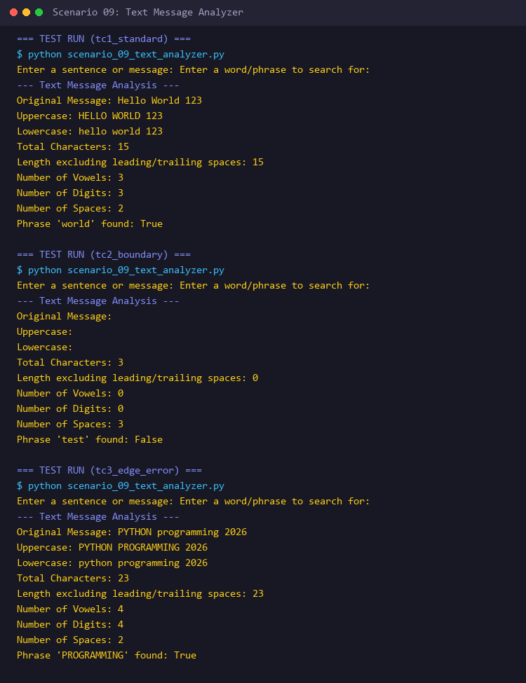

---

### Scenario 10: ATM Withdrawal Simulator
- **Inputs:** Account holder name (`str`), initial balance (`float`), transaction amounts (`float`), sentinel `'exit'`.
- **Processing:**
  1. Multi-transaction loop tracking balance, successful transaction count, and total dispensed cash.
  2. Validate: withdrawal $> 0$, exact multiple of Rs. 500 (`amount % 500 == 0`), and withdrawal $\le$ current balance.
  3. Failed transactions preserve balance and statistics without deduction.
- **Expected Outputs:** Real-time transaction feedback, remaining balance updates, and final session summary.
- **Screenshot:** 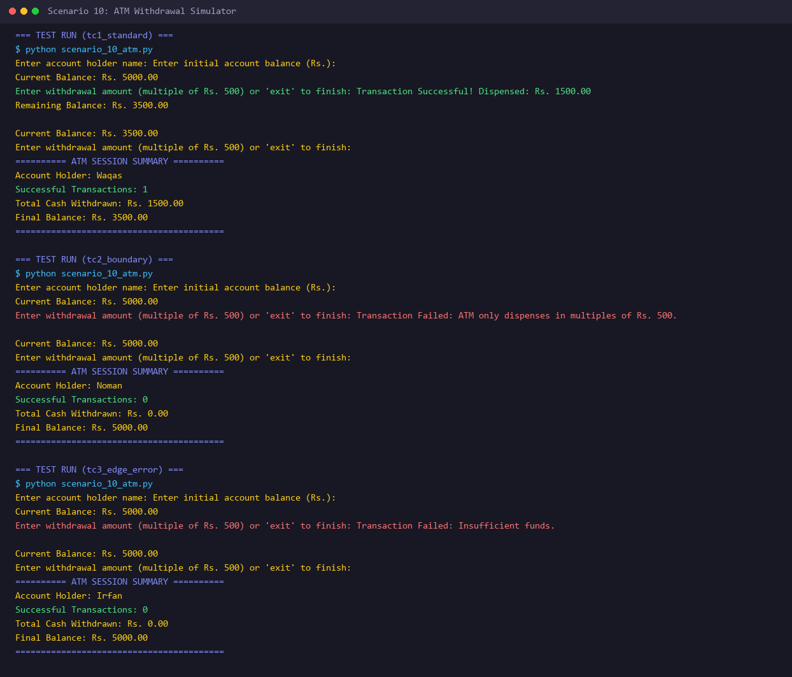

---

### Scenario 11: Number Guessing Game
- **Inputs:** Player name (`str`), guessed integers (`int`).
- **Processing:**
  1. Secret number preset to 42; maximum allowed attempts set to 7.
  2. Range validation: guesses outside $1 - 100$ rejected without consuming attempt count.
  3. Provide directional hints ("Too high!", "Too low!").
  4. Terminate on exact match or exhaust 7 attempts and reveal secret number.
- **Expected Outputs:** Attempt counter, win/loss congratulations or game-over message with revealed secret number.
- **Screenshot:** 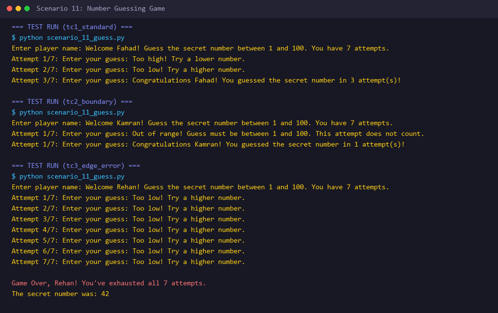

---

### Scenario 12: Employee Attendance and Salary Assessment
- **Inputs:** Employee name (`str`), daily wage (`float`), daily attendance status for 26 days (`'P'` or `'A'`).
- **Processing:**
  1. Counted loop for 26 days with inner reprompt loop rejecting any character other than 'P' or 'A'.
  2. Count total present days and absent days.
  3. Calculate salary = $\text{present\_days} \times \text{daily\_wage}$.
  4. Calculate attendance percentage = $(\text{present\_days} / 26) \times 100$.
  5. Issue threshold warning if attendance $< 80.0\%$.
- **Expected Outputs:** Attendance summary (present/absent), attendance percentage, total monthly salary, and low attendance warning if triggered.
- **Screenshot:** 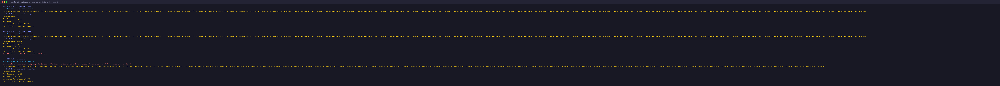

---

### Scenario 13: Restaurant Table Reservation and Seating Plan
- **Inputs:** Number of rows (`int`), seats per row (`int`), arriving customer count (`int`).
- **Processing:**
  1. Validate positive dimensions. Compute total capacity = $\text{rows} \times \text{seats\_per\_row}$.
  2. Generate 2D sequential layout using nested loops with 2-digit zero-padded seat numbers (`[01] [02] ...`).
  3. Validate customer count: reject negative values and reject numbers exceeding total capacity.
  4. Calculate unoccupied seats = $\text{total\_capacity} - \text{customers}$.
- **Expected Outputs:** Formatted row-by-row seat chart, reservation confirmation, and unoccupied count.
- **Screenshot:** 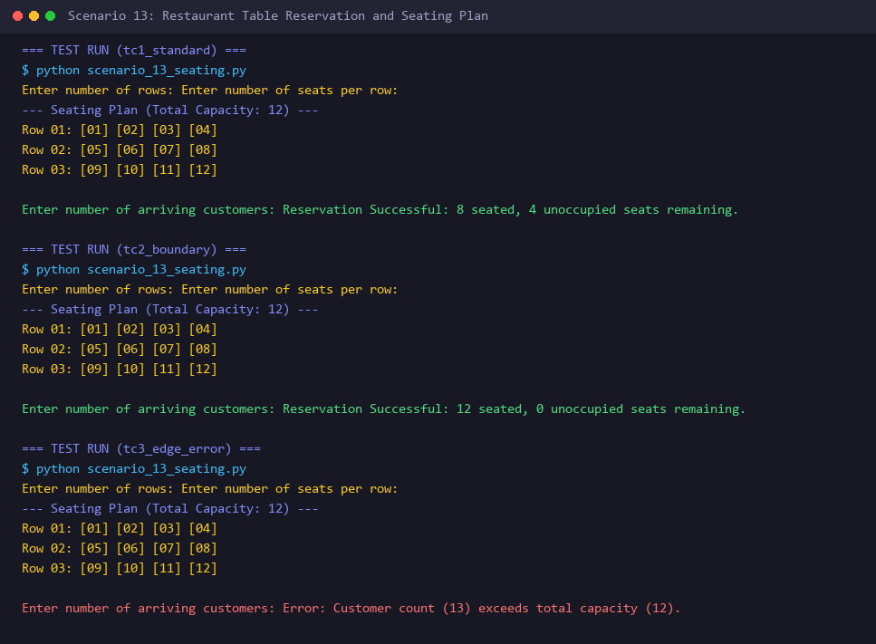

---

### Scenario 14: Daily Temperature Monitoring
- **Inputs:** Number of days to monitor (`int`), daily temperature values in °C (`float`).
- **Processing:**
  1. Reprompt until days $> 0$.
  2. Track running aggregates on the fly without lists: `total_temp`, `highest`, `lowest`.
  3. Increment multi-band counters: $> 35^\circ\text{C}$, $< 10^\circ\text{C}$, and between $10^\circ\text{C}$ and $35^\circ\text{C}$ inclusive.
  4. Compute average temperature = $\text{total\_temp} / \text{days}$.
- **Expected Outputs:** Comprehensive weather report with average, maximum, minimum, and day counts in each temperature band.
- **Screenshot:** 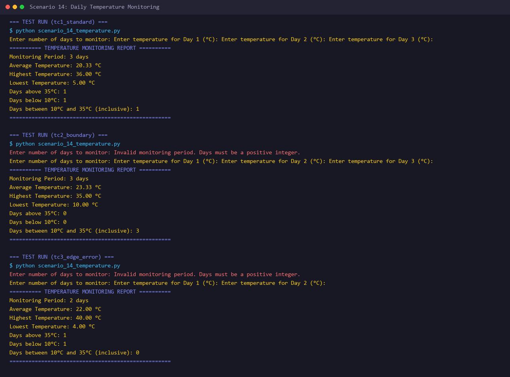

---

### Scenario 15: Digital Savings Goal Tracker
- **Inputs:** Student name (`str`), laptop savings goal (`float`), initial savings (`float`), weekly deposit amounts (`float`).
- **Processing:**
  1. Validate goal $> 0$ and initial savings $\ge 0$.
  2. If initial savings $\ge$ goal, terminate immediately in 0 weeks.
  3. While balance $<$ goal, accept weekly deposits, reject negative deposits without penalty, and accumulate savings.
  4. Allow voluntary early termination via `'stop'`.
- **Expected Outputs:** Weekly remaining balance updates, total accumulated amount, weeks elapsed, and final target achievement status.
- **Screenshot:** 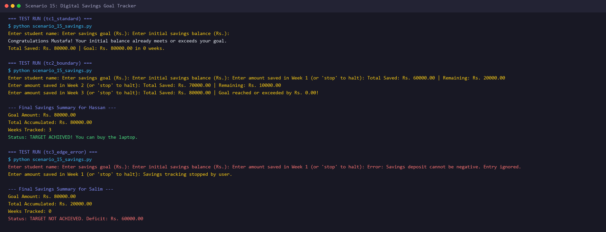

---

### Scenario 16: Cinema Ticket Booking and Revenue Report
- **Inputs:** Customer ages (`int`), termination sentinel `'done'`.
- **Processing:**
  1. Categorize each customer:
     - Child ($< 12$ years): Rs. 300
     - Adult ($12 - 59$ years): Rs. 600
     - Senior ($\ge 60$ years): Rs. 400
  2. Reject negative ages.
  3. Maintain category counters, total tickets sold, and total revenue.
  4. Guard against zero division when computing average ticket price.
- **Expected Outputs:** Ticket count breakdown by category, total tickets, gross box office revenue, and average ticket price.
- **Screenshot:** 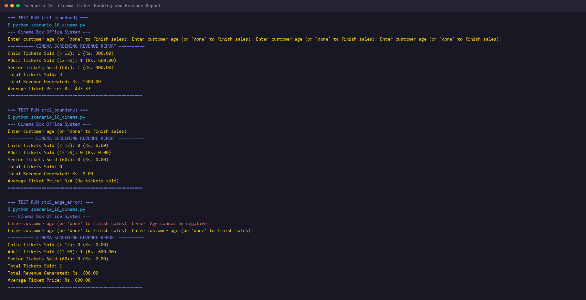

---

### Scenario 17: Multiplication Practice and Performance Report
- **Inputs:** Student name (`str`), table number (`int`), number of questions (`int`), student answers (`int`).
- **Processing:**
  1. Validate positive table number and question count.
  2. Iterate $1$ to $N$, presenting $\text{table\_num} \times i$, prompting for answers.
  3. Compare against mathematical product, provide instant feedback, and maintain correct/incorrect counters.
  4. Compute percentage score and assign four-tier performance rating.
- **Expected Outputs:** Question prompts, answer evaluation, final score percentage, and qualitative performance badge.
- **Screenshot:** 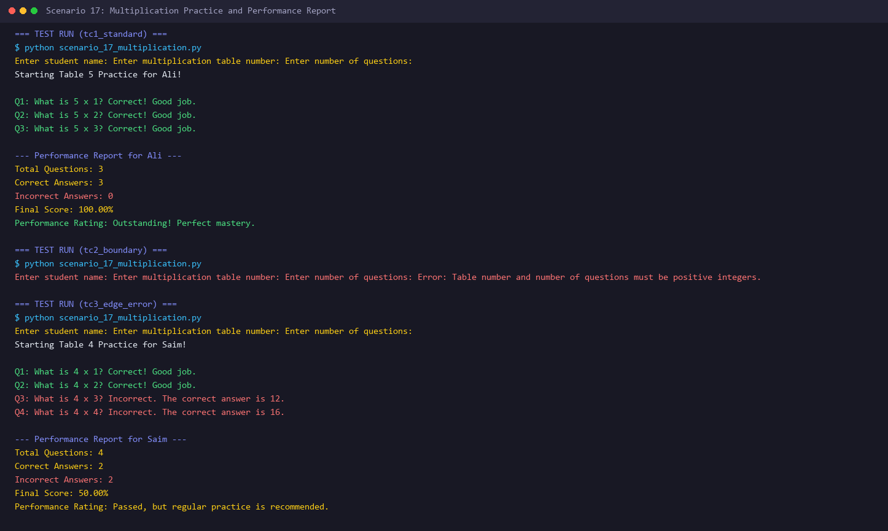

---

### Scenario 18: Simple Sales Performance Dashboard
- **Inputs:** Number of employees (`int`), employee names (`str`), sales figures (`float`).
- **Processing:**
  1. Validate employee count $\ge 0$; handle zero-employee report safely.
  2. Validate each employee's sales $\ge 0$ via reprompting loop.
  3. Accumulate total sales, count employees meeting Rs. 10,000 threshold.
  4. Accumulate employee sales breakdown into a formatted display string.
  5. Track highest sales online: if a strictly greater figure arrives, update top employee and reset tie flag; if an exact duplicate arrives, toggle tie flag.
- **Expected Outputs:** Individual breakdown, total sales, average sales per employee, count of target achievers, and top performer / tie announcement.
- **Screenshot:** 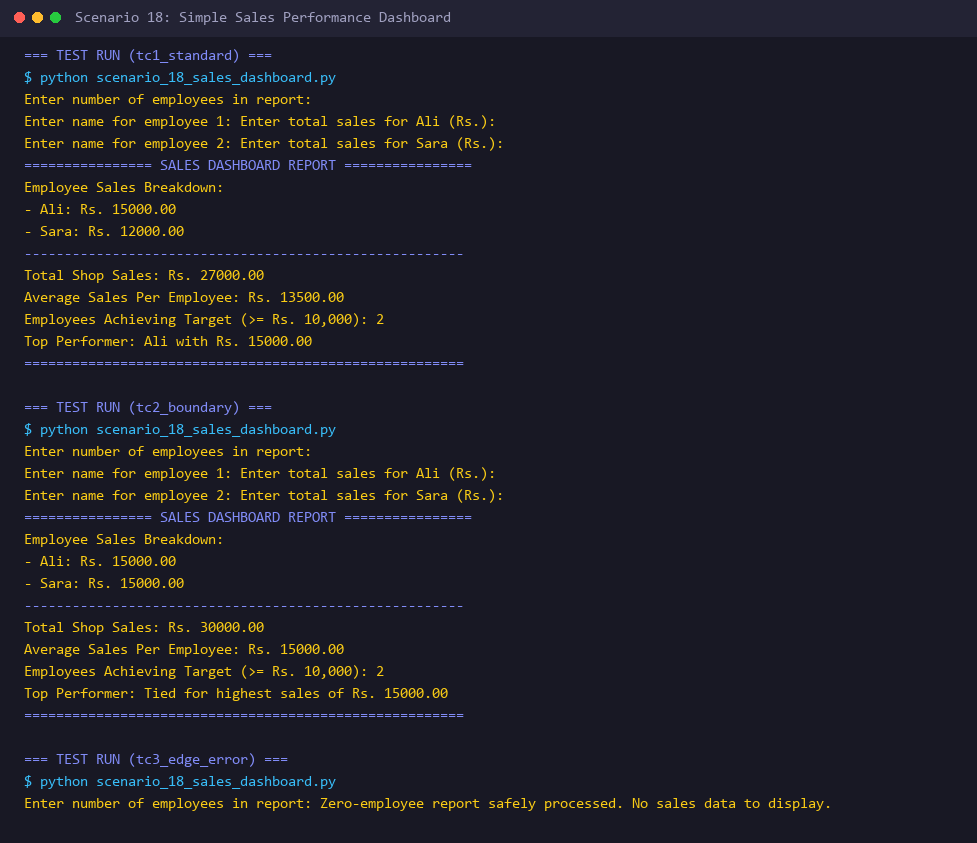

---

## Master Verification & Test Plan Table

| Scenario | Test Case 1 (Standard) | Test Case 2 (Boundary) | Test Case 3 (Error / Edge) |
|---|---|---|---|
| **01: Admission** | Inter: 800/1100 (72.73%), Test: 75/100 (75.00%) $\rightarrow$ **ELIGIBLE** | Inter: 660/1100 (60.00%), Test: 50/100 (50.00%) $\rightarrow$ **ELIGIBLE** | Inter: -10/1100 or 1200/1100 $\rightarrow$ **Rejected** |
| **02: Electricity** | 250 units $\rightarrow$ Rs. 3,500.00 | 100 units $\rightarrow$ Rs. 1,000.00; 200 units $\rightarrow$ Rs. 2,500.00 | -15 units $\rightarrow$ **Error rejected** |
| **03: Password** | `Pa$$word1` $\rightarrow$ **ACCEPTABLE** | `Pass1` (5 chars) $\rightarrow$ **Missing length** | `password` $\rightarrow$ **Missing uppercase and digit** |
| **04: Cafeteria** | Burger (400) + Sandwich (250) = Rs. 650.00 | 4 Burgers (1600) $\rightarrow$ 10% disc (160), Final Rs. 1,440.00 | Invalid item code or 0 qty $\rightarrow$ **Handled & reprompted** |
| **05: Budget** | Allowance: 20000, Exp: 15000 (75%) $\rightarrow$ **Within Budget** | Allowance: 20000, Exp: 17000 (85%) $\rightarrow$ **>80% Warning** | Allowance: 0 $\rightarrow$ **Handled safely** |
| **06: Transport** | Dist: 10 km, Age: 25 $\rightarrow$ Base Rs. 100.00 | Dist: 5.0 km, Age: 60 $\rightarrow$ Base Rs. 50, 20% disc, Rs. 40.00 | Dist: -5 or Age: -1 $\rightarrow$ **Error rejected** |
| **07: Checkout** | Subtotal Rs. 3,000 $\rightarrow$ 5% disc, Final Rs. 2,850.00 | Subtotal Rs. 5,000 $\rightarrow$ 10% disc, Final Rs. 4,500.00 | Price: -100 or Qty: 0 $\rightarrow$ **Handled & skipped** |
| **08: Library** | 12 days late $\rightarrow$ Rs. 250.00 | 0 days late $\rightarrow$ **No fine (on time)** | -3 days late $\rightarrow$ **Error rejected** |
| **09: Analyzer** | "Hello World 123" $\rightarrow$ Vowels: 3, Spaces: 2, Digits: 3 | " " (3 spaces) $\rightarrow$ Excluded len: 0 | Phrase search case-insensitivity verified |
| **10: ATM** | Withdraw Rs. 1,500 with Rs. 5,000 balance $\rightarrow$ **Dispensed** | Withdraw Rs. 750 $\rightarrow$ **Rejected (not multiple of 500)** | Withdraw Rs. 6,000 with Rs. 5,000 balance $\rightarrow$ **Insufficient** |
| **11: Guessing** | Guess 42 in 3 tries $\rightarrow$ **Win** | Guess 105 $\rightarrow$ **Out-of-range, attempt preserved** | 7 incorrect guesses $\rightarrow$ **Secret number revealed** |
| **12: Attendance** | 24 P, 2 A $\rightarrow$ 92.31%, salary calculated | 20 P, 6 A $\rightarrow$ 76.92% ($<80\%$ warning) | Entry 'X' $\rightarrow$ **Reprompts until 'P'/'A'** |
| **13: Seating** | 3 rows, 4 seats $\rightarrow$ 12 numbered seats generated | 12 capacity, 12 customers $\rightarrow$ 0 unoccupied | 13 customers for 12 capacity $\rightarrow$ **Capacity error** |
| **14: Temp** | 3 days: 36, 20, 5 $\rightarrow$ Max: 36, Min: 5, Avg: 20.33 | Days entered $\le 0 \rightarrow$ **Reprompted** | Counts in each of the 3 bands match exactly |
| **15: Savings** | Goal: 80000, Initial: 80000 $\rightarrow$ **0 weeks needed** | Goal: 80000, Initial: 50000, 3 weeks of 10000 $\rightarrow$ **Achieved** | Negative weekly amount $\rightarrow$ **Rejected & ignored** |
| **16: Cinema** | Ages: 10, 25, 65 $\rightarrow$ 1 child, 1 adult, 1 senior = Rs. 1,300 | 0 tickets sold $\rightarrow$ **Average price handled as N/A** | Negative age $\rightarrow$ **Rejected** |
| **17: Tables** | Table 5, 3 questions $\rightarrow$ All correct = 100% | Table 0 or -1 questions $\rightarrow$ **Rejected** | 2 of 4 correct $\rightarrow$ **50% rating** |
| **18: Dashboard** | Ali (15000), Sara (12000) $\rightarrow$ Ali top, 2 hit target | Ali (15000), Sara (15000) $\rightarrow$ **Handled as a tie** | 0 employees entered $\rightarrow$ **Handled safely** |

---

## Critical Reflection: Overcoming Constraint Challenges
The central pedagogical challenge of this assignment was solving analytical tracking and statistical reporting tasks under the **strict restriction against Python lists, dictionaries, custom functions, or external data structures**.

In conventional software development, scenarios such as **Scenario 14 (Daily Temperature Monitoring)** and **Scenario 18 (Simple Sales Performance Dashboard)** are trivially implemented by appending user inputs to a list and calling built-in utilities such as `min()`, `max()`, `sum()`, and sorting functions. Without lists, storing records in memory is forbidden. This required formulating **online single-pass algorithms** using state variables and accumulators:
1. **Dynamic Extremum & Tie Tracking:** In Scenario 18, finding the highest-selling employee and detecting ties required maintaining four synchronized scalar variables: `max_sales`, `top_employee`, `is_tied` (a boolean flag), and an accumulator string `employee_summary_string`. On the first iteration, the first employee's figures initialized the benchmark. On each subsequent iteration, when a candidate strictly exceeded `max_sales`, `max_sales` and `top_employee` were updated while `is_tied` was reset to `False`. If an incoming sales figure was exactly equal to `max_sales`, `is_tied` was flipped to `True`. This eliminated false claims of a unique winner while honoring zero-list memory constraints.
2. **Online Sequence Aggregation:** In Scenario 14, computing multi-band frequency distributions, cumulative averages, and running extrema was achieved in $O(1)$ auxiliary space by evaluating temperature readings directly within the daily input loop.
3. **Cumulative Summary Formatting via String Accumulation:** Because employee breakdown lines could not be cached in a list for deferred printing, string concatenation was used (`employee_summary_string += f"- {emp_name}: Rs. {sales:.2f}\n"`), enabling the generation of an itemized dashboard after the summary calculations concluded.

This exercise deepened our understanding of core computational fundamentals, demonstrating that sophisticated business reporting, input sanitization, and state monitoring can be engineered using purely foundational programming constructs.

---

## Submission Checklist Verification
- [x] All 18 Python scripts created with exact canonical filenames (`scenario_01_admission.py` through `scenario_18_sales_dashboard.py`).
- [x] Strict compliance with zero advanced features (no lists, dictionaries, custom functions, or external packages).
- [x] Structured `README.md` complete with scenario index, input-processing-output breakdown, test cases, and reflection.
- [x] High-resolution terminal screenshots generated for all 18 scenarios and stored in `screenshots/`.
- [x] Archive compressed and verified as `MSDSF25A007_Python_asg_01.zip`.
